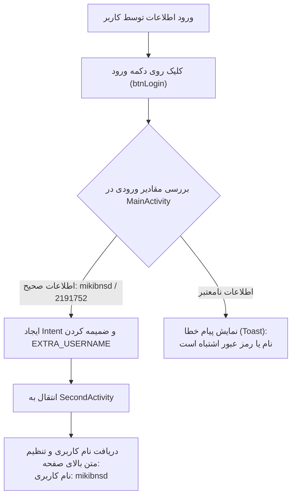

# تحلیل و آنالیز خط‌به‌خط کدهای پروژه (Code Analysis)

این سند شامل تحلیل دقیق، خط‌به‌خط و ساختاری تمامی فایل‌های سورس کد پروژه اندروید احراز هویت است.

---

## ۱. چرخه اجرا و معماری برنامه (Flow Chart)

---

## ۲. آنالیز فایل `MainActivity.java`

این کلاس مسئولیت دریافت اطلاعات ورودی کاربر، اعتبارسنجی مقادیر و مدیریت انتقال به صفحه بعد را بر عهده دارد:

| خط کد | توضیح و نقش در برنامه |
| :--- | :--- |
| `package com.example.loginapp;` | تعیین پکیج پروژه جهت مدیریت ساختار فایل‌ها |
| `import androidx.appcompat.app.AppCompatActivity;` | افزودن کلاس پایه اکتیویتی‌های مدرن اندروید |
| `import android.content.Intent;` | افزودن کلاس Intent برای جابه‌جایی میان اکتیویتی‌ها و تبادل داده |
| `import android.widget.Toast;` | برای نمایش پیغام‌های شناور کوتاه به کاربر |
| `private EditText etUsername;` | متغیر نگه‌دارنده ارجاع فیلد متنی نام کاربری |
| `private EditText etPassword;` | متغیر نگه‌دارنده ارجاع فیلد متنی رمز عبور |
| `private Button btnLogin;` | متغیر نگه‌دارنده ارجاع دکمه لاگین |
| `private final String VALID_USERNAME = "mikibnsd";` | نام کاربری معتبر ثابت تعریف شده توسط سناریوی پروژه |
| `private final String VALID_PASSWORD = "2191752";` | رمز عبور معتبر ثابت تعریف شده توسط سناریوی پروژه |
| `setContentView(R.layout.activity_main);` | بارگذاری و ترسیم فایل چیدمان XML روی صفحه نمایش |
| `etUsername = findViewById(R.id.etUsername);` | متصل کردن فیلد گرافیکی به متغیر جاوایی از طریق شناسه |
| `btnLogin.setOnClickListener(...);` | شنود رویداد کلیک دکمه ورود برای اجرای کدهای احراز هویت |
| `String inputUsername = etUsername.getText().toString().trim();` | استخراج متن تایپ‌شده و پاکسازی فاصله‌های خالی ابتدا و انتها |
| `if (inputUsername.equals(VALID_USERNAME) && ...)` | مقایسه مقدار متنی نام کاربری و پسوورد با استفاده از متد `.equals()` |
| `Intent intent = new Intent(MainActivity.this, SecondActivity.class);` | تعریف مسیر انتقال از صفحه اول به صفحه مقصد (`SecondActivity`) |
| `intent.putExtra("EXTRA_USERNAME", inputUsername);` | ذخیره نام کاربری معتبر در قالب کلید-مقدار درون بسته ارسالی اینتنت |
| `startActivity(intent);` | شروع چرخه حیات و نمایش اکتیویتی دوم |
| `Toast.makeText(..., "نام یا رمز عبور اشتباه است", ...).show();` | نمایش اعلان خطا در صورت عدم تطابق اطلاعات وارد شده |

---

## ۳. آنالیز فایل `SecondActivity.java`

این کلاس مسئولیت دریافت اطلاعات تحویل داده شده توسط اینتنت و نمایش اختصاصی نام کاربری در بالای اکتیویتی دوم را داراست:

| خط کد | توضیح و نقش در برنامه |
| :--- | :--- |
| `private TextView tvDisplayUsername;` | متغیر نمایش‌دهنده متن در بالای صفحه |
| `setContentView(R.layout.activity_second);` | بارگذاری ظاهر اکتیویتی دوم |
| `tvDisplayUsername = findViewById(R.id.tvDisplayUsername);` | پیوند متغیر با المان متنی قرار گرفته در بالای صفحه |
| `String username = getIntent().getStringExtra("EXTRA_USERNAME");` | استخراج نام کاربری منتقل شده از Intent با کلید اختصاصی |
| `tvDisplayUsername.setText("نام کاربری: " + username);` | درج عبارت «نام کاربری: » به علاوه مقدار دریافت شده در بالای صفحه |

---

## ۴. آنالیز فایل چیدمان `activity_main.xml`

- **`<LinearLayout ... orientation="vertical" gravity="center">`**: ریشه اصلی صفحه که تمام کنترل‌ها را به صورت عمودی و در مرکز صفحه مرتب می‌کند.
- **`<EditText android:id="@+id/etUsername" ... hint="نام کاربری" />`**: کادر متنی دریافت نام کاربری با متن راهنما (Hint).
- **`<EditText android:id="@+id/etPassword" ... inputType="textPassword" />`**: کادر دریافت پسوورد که نوع ورودی آن روی `textPassword` قرار داده شده تا کاراکترها پنهان گردند.
- **`<Button android:id="@+id/btnLogin" ... text="ورود" />`**: دکمه اکشن جهت آغاز اعتبارسنجی.

---

## ۵. آنالیز فایل چیدمان `activity_second.xml`

- **`<TextView android:id="@+id/tvDisplayUsername" ... layout_marginTop="20dp" ... />`**: کامپوننت متنی شاخصی که در **بالای اکتیویتی دوم** تعبیه شده و فرمت `نام کاربری: mikibnsd` روی آن اعمال می‌شود.
- **پیام خوش‌آمدگویی**: متن ثانویه برای ارائه بازخورد بصری مثبت به کاربر پس از ورود موفق.

---

## ۶. آنالیز فایل `AndroidManifest.xml`

- **معرفی اکتیویتی اول به عنوان Launcher**:
  با تگ‌های `<action android:name="android.intent.action.MAIN" />` و `<category android:name="android.intent.category.LAUNCHER" />` به سیستم عامل اطلاع می‌دهد که هنگام کلیک روی آیکون برنامه، این اکتیویتی را باز کند.
- **معرفی `SecondActivity` با `exported="false"`**:
  به منظور حفظ امنیت برنامه، دسترسی مستقیم اپ‌های دیگر به اکتیویتی دوم مسدود شده و تنها از درون خود اپ باز می‌شود.
